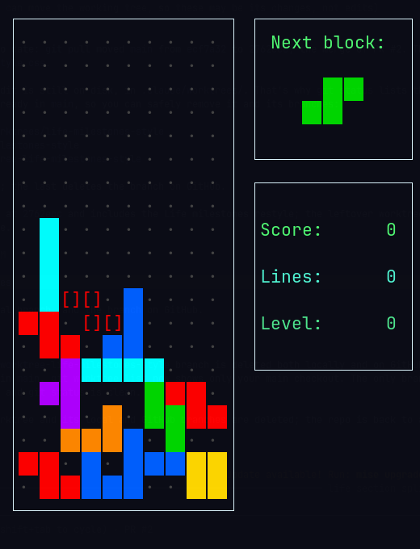

# dqtris

A personal fork of [Bastet](https://github.com/fph/bastet) ("bastard Tetris"), the ncurses
Tetris clone that deliberately picks the *worst* possible next piece. The evil block-chooser
is untouched, but dqtris adds a fair mode for when you'd rather not be bullied, and makes
losing to the bastard look better.

<p align="center">
  
  &nbsp;&nbsp;
  
  <br>
  <em>dqtris (left) vs. the original bastet (right)</em>
</p>

## What's different

- **Fair mode.** Pieces come from a shuffled "bag" of all seven tetrominoes, as in modern
  Tetris, so you never wait forever for an I piece. The bastard modes are still there.
- **Separate high scores.** One board each for Fair, Bastard and Bastard (no preview).
  dqtris keeps its own `~/.dqtrisrc` and `~/.dqtrisscores`; on first run it copies your keys
  and scores from bastet's files, which it leaves alone.

- **Classic colours.** On 256-colour terminals, every tetromino gets its familiar colour:
  I cyan, O yellow, T purple, S green, Z red, J blue, L orange.
  (The original drew O white and L yellow because the basic 8 ANSI colours have no orange.)
- **Ghost piece.** A `[]` outline in the falling piece's colour shows exactly where it will
  land on a hard drop.
- **Background grid.** A faint dot in every empty cell makes it easy to see which column
  you're in.
- **Tile gaps.** A thin dark gap between squares, so you can count cells in a stack.
- **Resize-safe.** Stock bastet goes blank when its terminal is resized, which happens all the
  time under a tiling window manager. dqtris re-centres and redraws the game, the pause
  dialog and the menus on every resize.

Everything else (scoring, keys, the bastard algorithm) is upstream bastet.

## Build

Requirements: a C++ compiler, `ncurses` and Boost (`program_options` plus headers).

```sh
make
./dqtris
```

If the Boost headers live somewhere non-standard:

```sh
make CPPFLAGS=-I/path/to/boost/include
```

To run it as `dqtris`, add an alias to your shell config:

```sh
alias dqtris="$HOME/code/dqtris/dqtris"
```

The new visuals need a 256-colour terminal with a font that has the `▕` glyph (most modern
terminals and Nerd Fonts do). On 8-colour terminals it falls back to the original look.

## Keys

| Key            | Action                                  |
| -------------- | --------------------------------------- |
| Left / Right   | Move                                    |
| Down           | Soft drop                               |
| Space          | Rotate clockwise                        |
| Up             | Rotate counter-clockwise                |
| Enter          | Hard drop (to where the ghost piece is) |
| p              | Pause                                   |

Keys can be changed from the in-game menu.

## Credits and licence

Bastet is © 2005–2009 Federico Poloni and contributors, see [AUTHORS](AUTHORS) and the
original [README](README). dqtris changes are by Dimitrios Kiousis. Like the original, this
fork is licensed under the [GNU GPL v3](LICENSE) or later.
